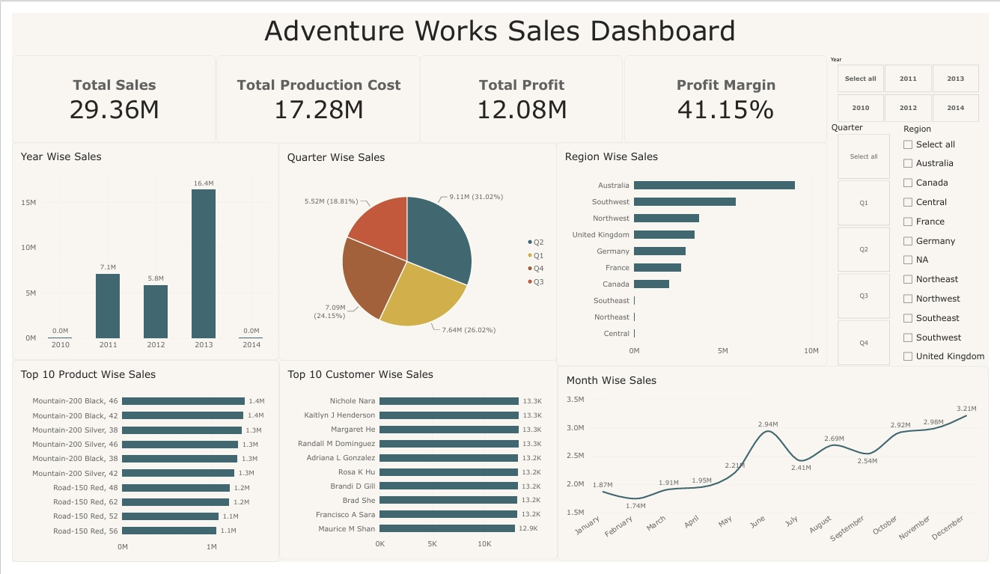
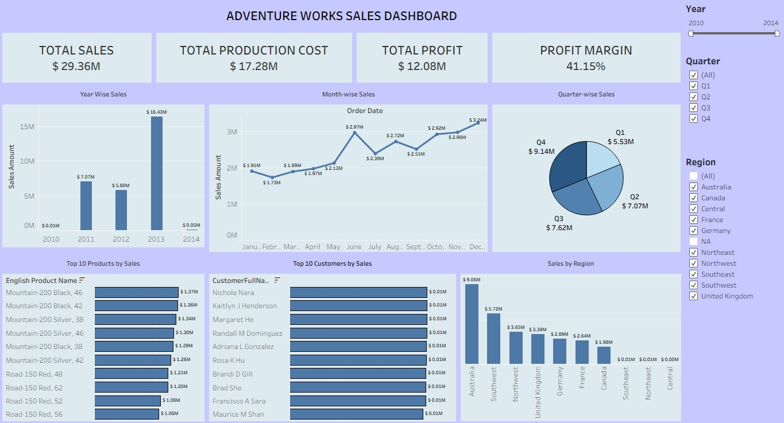
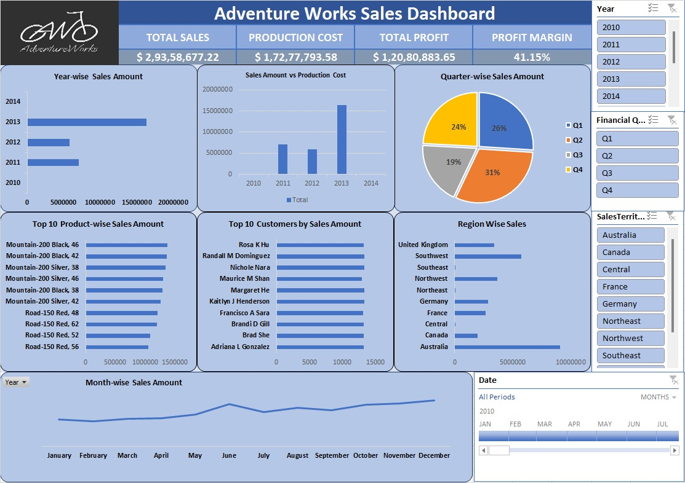

# Adventure Works Sales Analysis & BI Dashboard
End-to-end sales analysis and BI dashboards on the Adventure Works dataset using MySQL, Excel, Power BI and Tableau.

## Objective
Analyze sales performance for Adventure Works and build dashboards
for KPIs, trends, regions, customers and products.

## Tools Used
MySQL | Excel (Power Query, Power Pivot) | Power BI (DAX) | Tableau

## What I Did
- Combined two sales tables (~60K records) in MySQL using UNION ALL
  and joined them with product and customer dimensions
- Built date fields (year, quarter, month, weekday, financial month
  and quarter)
- Calculated Sales Amount, Production Cost, Profit and Profit Margin
- Built the same dashboard in Excel, Power BI and Tableau

## Key Insights
- Total sales of about $29.36M, with a profit of $12.08M (41.15% profit margin)
- Australia is the top region, contributing 30.9% of total sales, followed by Southwest (19.5%) and Northwest (12.4%)
- The Mountain-200 bike range dominates product sales. The top product is Mountain-200 Black, 46, at about $1.37M
- Sales peak in Q4 (31% of the total), with December the strongest month
- 2013 was the highest sales year, with 55.7% of total sales

## Dashboard Screenshots
### Power BI

### Tableau

### Excel

